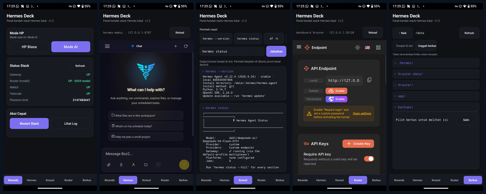
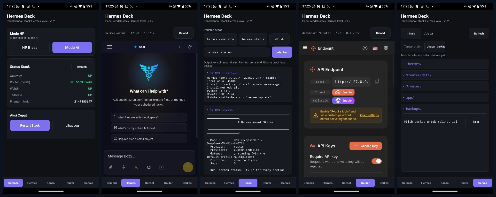

# Hermes Deck

**Panel kendali satu pintu untuk tumpukan AI (Hermes Agent + 9router) yang hidup mandiri di sebuah ponsel Android.**

Hermes Deck mengubah Redmi Note 5 (*whyred*, LineageOS Android 14, root KernelSU) menjadi rumah permanen bagi [Hermes Agent](https://github.com/NousResearch) dan router model 9router: gateway Telegram, router LLM, dan web UI berjalan di dalam Ubuntu proot di ponsel, menyala otomatis sesudah reboot, dan seluruhnya dikendalikan dari satu aplikasi Android + satu modul root. Tanpa server, tanpa VPS, tanpa panel web yang tersebar.



*Kolase: Beranda, Hermes (web UI), Konsol, Router (dashboard 9router), Berkas.*



*Tangkapan layar dari perangkat pengguna: kelima tab berjalan bersamaan — stack UP semua, router memuat 5.659 model, konsol menjalankan `hermes status`, dan explorer Berkas membuka `/data`.*

---

## Daftar isi

- [Mengapa proyek ini ada](#mengapa-proyek-ini-ada)
- [Arsitektur](#arsitektur)
- [Fitur aplikasi (5 tab)](#fitur-aplikasi-5-tab)
- [Fitur modul root](#fitur-modul-root)
- [Referensi deckctl](#referensi-deckctl)
- [Agen Pembantu: akses jarak jauh yang mati secara default](#agen-pembantu-akses-jarak-jauh-yang-mati-secara-default)
- [Instalasi](#instalasi)
- [Membangun APK dari sumber](#membangun-apk-dari-sumber)
- [Riwayat versi](#riwayat-versi)
- [Pelajaran teknis](#pelajaran-teknis)
- [Status & batasan](#status--batasan)

## Mengapa proyek ini ada

Tumpukan Hermes awalnya berjalan di VPS sewaan yang berulang kali kena kunci *abuse* dan mati. Ponsel lama yang tergeletak ternyata cukup: Snapdragon 636 + RAM 4 GB sanggup menjalankan gateway + router + web UI sekaligus, gratis, dan selalu menyala di rumah. Yang kurang hanyalah cara mengendalikannya tanpa membuka Termux dan mengetik perintah setiap kali — itulah Hermes Deck.

Prinsip desainnya:

1. **Satu sumber kebenaran.** Mode ponsel adalah satu berkas teks (`/data/adb/hermes_deck/mode`). Semua komponen membaca/menulis berkas itu; tidak ada dua pengendali yang boleh bertarung.
2. **Satu jalur kendali.** Aplikasi, watchdog, dan CLI manual semuanya memanggil skrip yang sama: `deckctl.sh`.
3. **Mandiri secara default.** Sesudah reboot, semuanya naik sendiri. Akses jarak jauh (SSH + Tailscale) adalah saklar terpisah yang **mati secara default** dan hanya dinyalakan saat asisten perlu masuk.
4. **Jujur soal batas.** Setiap kegagalan historis (dan obatnya) tercatat di [riwayat versi](#riwayat-versi) dan [pelajaran teknis](#pelajaran-teknis), bukan disembunyikan.

## Arsitektur

```
+--------------------------------------------------------------+
|  Aplikasi Hermes Deck (Kotlin, tanpa framework UI)           |
|  Beranda | Hermes | Konsol | Router | Berkas                 |
+-------------------------+------------------------------------+
                          |  su -c deckctl.sh <perintah>
+-------------------------v------------------------------------+
|  deckctl.sh - satu-satunya jalur kendali                     |
|  mode | helper | status | restart | log | console | ls/cat   |
|  cp | put                                                    |
+------+--------------------+-----------------------+----------+
       | berkas mode        | IPC berkas            | cermin
       | (sumber kebenaran) | /data/adb/hermes_deck | ~/.deck-mode
+------v---------+  +-------v-----------------+  +--v-----------+
| Modul root     |  | relay.sh (konteks modul,|  | Agen Termux  |
| (KernelSU/     |  | namespace global):      |  | (domain      |
| Magisk):       |  | sinkron cermin mode &   |  | aplikasi):   |
| watchdog       |  | helper dua arah, layani |  | naikkan stack|
| service.sh:    |  | IPC ls/cat/cp/put,      |  | (gateway tak |
| hardening +    |  | teruskan konsol ke agen,|  | bisa lahir di|
| jaga sshd*     |  | cache jumlah model      |  | domain su)   |
+----------------+  +-------------------------+  +------+-------+
                                                        |
                          +-----------------------------v--------+
                          | Stack di Ubuntu proot (/data):       |
                          | gateway Hermes (Telegram)            |
                          | 9router :20128 (5.600+ model)        |
                          | hermes-webui :8787                   |
                          +--------------------------------------+
```

\* sshd hanya dijaga watchdog bila saklar Agen Pembantu aktif.

Dua jebakan Android membentuk arsitektur ini (detail di [Pelajaran teknis](#pelajaran-teknis)): aplikasi yang memanggil `su` tidak bisa melihat direktori Termux (kebutaan *mount namespace*) sehingga Berkas/Konsol harus dijembatani IPC berkas; dan proses yang lahir dari rantai `su` jatuh ke domain SELinux yang tidak bisa membuat socket, sehingga stack hanya boleh dilahirkan oleh agen Termux (domain aplikasi) atau proses konteks boot.

## Fitur aplikasi (5 tab)

### Beranda
- **Saklar Mode HP Biasa | Mode AI** — Mode AI menyalakan hardening + stack; HP Biasa menurunkan stack bersih dan mengembalikan ponsel sebagai HP normal. Tombol ter-*debounce* (mati selama perintah berjalan) — perbaikan atas bug v1.0 tempat ketukan berulang membuat dua pengendali bertarung dan stack *flap*.
- **Status Stack real-time** — gateway, router (+ jumlah model), web UI, Tailscale, SSH, dan batas *phantom process*; satu panggilan `ps` sehingga status tampil dalam ±0,6 detik (v1.0: semenit lebih).
- **Kartu Agen Pembantu** — saklar SSH + Tailscale, default mati (lihat [di bawah](#agen-pembantu-akses-jarak-jauh-yang-mati-secara-default)).
- **Kebangkitan otomatis (v1.4)** — bila Mode AI diketuk tetapi gateway tidak naik (agen Termux ikut mati karena Termux dibunuh sistem), aplikasi memanggil `deckctl resurrect` sendiri: agen dilahirkan ulang di dalam Termux lewat intent RUN_COMMAND, tanpa pengguna membuka Termux. Mode HP Biasa sebaliknya mematikan proses Termux itu sendiri (bila Agen Pembantu mati), jadi ponsel kembali bersih sepenuhnya sebagai HP harian.
- **Aksi cepat** — Restart Stack dan Lihat Log (gabungan log modul, gateway, router, web UI).

### Hermes
WebView ke **hermes-webui** lokal (`127.0.0.1:8787`) — antarmuka chat & manajemen Hermes Agent lengkap.

### Konsol
Terminal ke Ubuntu proot: perintah cepat (`hermes --version`, `hermes status`, `df -h`, …) atau perintah bebas. Setiap perintah otomatis dibungkus *environment* Hermes (`HERMES_HOME` + fungsi `hermes` ke venv ARM), jadi perintah `hermes …` langsung jalan — perbaikan atas bug "command not found" karena CLI Hermes adalah skrip Python di folder instalasinya, bukan biner di PATH. Eksekusi diteruskan lewat IPC ke agen Termux.

### Router
WebView ke **dashboard 9router** lokal (`127.0.0.1:20128`) — kelola provider, koneksi, combo, dan kunci API untuk 5.600+ model yang terdaftar di router.

### Berkas
Explorer sungguhan untuk sistem berkas AI (`/data` di dalam distro):
- Navigasi folder, lihat isi berkas teks (±64 KB), salin isi ke clipboard.
- **Salin/Tempel antar folder** — tekan lama berkas/folder untuk menyalin, ketuk *Tempel di sini* di folder tujuan. Anti-timpa: nama yang sudah ada otomatis diberi akhiran `(2)`, `(3)`, …
- **Unggah berkas dari penyimpanan ponsel** — pemilih berkas Android (SAF) standar; berkas mendarat di folder `/data` yang sedang dibuka.
- Semua operasi berjalan lewat IPC relay (`ls`, `cat`, `cp`, `put`) karena konteks aplikasi buta terhadap direktori Termux.

## Fitur modul root

Modul KernelSU/Magisk (`module/`, dapat di-zip menjadi modul flashable):

- **Watchdog** (`service.sh`) — menegaskan hardening tiap siklus: batas *phantom process* maksimum (2147483647, via `apply.sh`), menjaga stack sesuai mode, dan menjaga sshd **hanya bila** Agen Pembantu aktif.
- **Relay** (`relay.sh`) — proses konteks modul dengan namespace global: menyinkronkan cermin mode & helper ke Termux dua arah tiap ±2 detik (watchdog lama hanya menyinkron ke satu arah — sumber pertarungan master vs cermin di v1.0), melayani IPC Berkas/Konsol, meneruskan perintah konsol ke agen Termux, dan menulis cache jumlah model dari log router.
- **Agen Termux** (`module/termux/deck-agent.sh`, boot via `module/termux-boot/02-deck-agent.sh`) — menaikkan stack dari domain aplikasi (satu-satunya domain yang lolos membuat socket untuk gateway), menjaga gateway/router/web UI tetap hidup dengan *cooldown* anti-banjir, dan melayani IPC konsol.
- **Skrip stack** (`stack-router.sh`, `stack-webui.sh`) — peluncur router/web UI per-komponen bila hanya satu yang mati.
- **Gerbang boot** (`module/termux-boot/start-hermes.sh`) — skrip Termux:Boot: sshd hanya dinyalakan bila cermin Agen Pembantu bernilai `on`.

## Referensi deckctl

```
deckctl mode                 -> ai | biasa
deckctl mode ai|biasa        -> tulis mode + terapkan sekarang
deckctl helper               -> on | off
deckctl helper on|off        -> saklar Agen Pembantu (Tailscale + sshd)
deckctl status               -> baris key=value:
                                mode, helper, sshd, gateway, router,
                                models, webui, tailscale, phantom
deckctl restart              -> turunkan stack; agen menaikkan lagi <=10 dtk
deckctl log                  -> ekor log deck + gateway + router + webui
deckctl console <perintah>   -> jalankan di Ubuntu proot (timeout 120 dtk)
deckctl ls [relpath]         -> daftar isi folder di /data distro
deckctl cat <relpath>        -> isi berkas teks (maks ~64 KB)
deckctl cp <sumber> <folder-tujuan>   -> salin berkas/folder (anti-timpa)
deckctl put <berkas-staging> <folder-tujuan> -> masukkan berkas ke /data
```

`ls`/`cat`/`cp`/`put`/`console` otomatis memilih jalur langsung (bila rootfs terlihat) atau IPC berkas (bila pemanggil buta namespace). `DECK_FORCE_IPC=1` memaksa jalur IPC untuk pengujian.

## Agen Pembantu: akses jarak jauh yang mati secara default

Ponsel ini tidak butuh SSH maupun Tailscale untuk menjalankan Hermes — keduanya murni jalur masuk bagi asisten/pemilik dari jauh. Karena itu v1.3 memisahkannya menjadi saklar tersendiri:

- **Mati (default):** always-on VPN Tailscale dicabut, aplikasi Tailscale di-*force-stop*, sshd dibunuh, dan watchdog + skrip boot dilarang menyalakannya lagi.
- **Hidup:** always-on VPN dipasang kembali, aplikasi Tailscale dibuka (pastikan tampil *Connected*), dan sshd dinyalakan **oleh watchdog konteks boot** dalam ≤30 detik. (v2.3.0 sempat menyalakan sshd dari deckctl langsung; sshd-nya sakit karena domain SELinux — diperbaiki di v2.3.1.)

Konsekuensi yang disengaja: dengan Agen Pembantu mati, tidak ada satu pun jalur masuk dari jaringan — permukaan serangan ponsel sebagai server adalah nol, sementara seluruh fungsi AI tetap jalan.

Catatan terkait: dashboard 9router dan hermes-webui di perangkat ini berjalan **tanpa password** (hanya mengikat `127.0.0.1`). Keputusan itu aman selama relay publik ke router tidak aktif; bila suatu saat dashboard diekspos ke internet, password **wajib** dipasang kembali dulu.

## Instalasi

Prasyarat: ponsel root (KernelSU/Magisk), Termux + Termux:Boot, Ubuntu proot (`proot-distro`) berisi stack Hermes di `/data` (`.hermes`, `9router`, `9router-data`, `hermes-webui`), dan aplikasi Tailscale bila ingin memakai Agen Pembantu.

1. Zip isi `module/` sebagai modul dan pasang lewat KernelSU/Magisk, lalu reboot.
2. Salin `module/termux/deck-agent.sh` ke `~/deck-agent.sh` di Termux dan kedua berkas `module/termux-boot/` ke `~/.termux/boot/`.
3. Bangun APK (lihat di bawah) atau pakai APK rilis, lalu pasang: `pm install -r HermesDeck-v1.3.apk` (atau ketuk berkasnya).
4. Beri izin root untuk aplikasi Hermes Deck di KernelSU.
5. Buka aplikasi: pilih Mode AI; stack naik sendiri dalam ±10 detik.

## Membangun APK dari sumber

Aplikasi ditulis sebagai satu berkas Kotlin programatik (`app/src/com/hiroki/hermesdeck/MainActivity.kt`, tanpa Gradle/AndroidX) dan dibangun dengan `app/build.sh` (aapt2 + kotlinc + d8 + apksigner; butuh JDK 17, Kotlin, dan Android SDK build-tools). Kata sandi keystore disuplai lewat environment: `DECK_KS_PASS='…' ./build.sh` — tidak pernah ditulis di dalam skrip.

**Kunci tanda tangan (`deck.keystore`) sengaja TIDAK disertakan di repo ini.** APK produksi ditandatangani sertifikat yang sama sejak v1.0 agar bisa saling menimpa; tanpa keystore tersebut, build Anda menghasilkan APK bersertifikat lain yang harus diinstal setelah mencopot versi produksi. Jaga keystore Anda di luar repo, selalu.

## Riwayat versi

| Versi | Tanggal | Isi |
|---|---|---|
| Deck v1.0 / modul v2.0 | 10 Nov 2026 | Rilis pertama: 5 tab, saklar mode, watchdog + agen. Di lapangan ditemukan dua bug besar: kebutaan namespace aplikasi (Konsol/Berkas mati) dan deckctl lambat (pindai /proc berulang) yang memicu ketukan berulang dan pertarungan mode. |
| Deck v1.1 / modul v2.1 | 10 Nov 2026 | Relay modul baru (sinkron cermin dua arah + IPC), status satu panggilan `ps` (60 dtk → 0,6 dtk), debounce saklar, cache model. Uji: mode dua arah bersih, reboot hands-free lulus (relay menyala sendiri dari service modul, Telegram tersambung ±2 menit sesudah boot). |
| Deck v1.2 / modul v2.2 | 10 Nov 2026 | Konsol dibungkus environment Hermes (`hermes` CLI jalan); Berkas menjadi explorer: salin/tempel antar folder anti-timpa + unggah via SAF (op IPC `cp`/`put`). Di perangkat yang sama: dashboard 9router + web UI dijadikan tanpa password (localhost). |
| Deck v1.3 / modul v2.3 | 10 Nov 2026 | Saklar **Agen Pembantu** (SSH + Tailscale) terpisah, default mati: flag master + cermin, gerbang watchdog & boot, kartu + baris status SSH di Beranda. |
| modul v2.3.1 | 10 Nov 2026 | Patch deckctl: `helper on` tidak lagi menyalakan sshd langsung (domain SELinux) — sshd murni tugas watchdog konteks boot. |
| Deck v1.4 / modul v2.4 | 11 Nov 2026 | Mode menjadi saklar total untuk HP harian: **Mode Biasa mematikan semuanya termasuk proses Termux** (force-stop, bila Agen Pembantu mati) dan agen keluar sendiri; **Mode AI menghidupkan ulang agen dari luar** lewat perintah baru `deckctl resurrect` (intent RUN_COMMAND Termux, dengan anak tangga aktivitas bila Termux berstatus *stopped*) yang dipanggil aplikasi secara otomatis bila gateway belum naik. Syarat: `allow-external-apps = true` di termux.properties. Uji siklus penuh lulus: Biasa (Termux mati total) → Mode AI → semua hidup lagi tanpa membuka Termux. |

Catatan desain dan rencana awal tersimpan di [docs/DESIGN-NOTES.md](docs/DESIGN-NOTES.md).

## Pelajaran teknis

Hal-hal yang dibayar mahal selama pengembangan, dicatat agar tidak diulang:

- **Mount namespace Android itu per-proses.** Aplikasi yang memanggil `su` mewarisi namespace-nya sendiri dan tidak bisa melihat `/data/data/com.termux/**` — semua akses lintas konteks harus lewat perantara yang hidup di namespace global (relay modul) atau di konteks pemilik data (agen Termux). IPC berkas sederhana (folder `req/`/`res/`) terbukti cukup dan tangguh.
- **Domain SELinux menentukan nasib socket.** Proses turunan rantai `su` interaktif jatuh ke domain `su` dan gagal membuat socket (gateway: `PermissionError`; sshd: menerima koneksi lalu menutup tanpa banner). Proses yang sama berjalan sehat bila dilahirkan dari konteks aplikasi Termux atau konteks boot/init. Aturan praktisnya: *yang membuat socket harus lahir di domain yang benar; root hanya boleh menulis flag.*
- **Satu sumber kebenaran atau tidak sama sekali.** Dua penulis untuk satu keadaan (file mode master vs cermin) tanpa aturan sinkron yang jelas melahirkan pertarungan dan *flapping*. Sekarang: master di modul, cermin satu arah oleh relay, semua pihak lain hanya membaca.
- **Kecepatan UI adalah fitur keamanan perilaku.** Status yang butuh semenit membuat pengguna mengetuk berulang, dan ketukan berulang itu sendiri menjadi bug (mode ditulis berkali-kali). Status 0,6 detik + debounce menghapus kelas bug itu.
- **Verifikasi dari berkas, bukan dari klaim.** Setiap kesimpulan (siapa yang melayani, kapan jendela berakhir, apakah layanan mati) wajib dicek dari log/berkas keadaan di perangkat, bukan dari ingatan atau ringkasan.

## Status & batasan

- **Produksi** di whyred sejak 10 Nov 2026; migrasi dari VPS, uji reboot hands-free, dan uji aplikasi dari sisi pengguna semuanya lulus.
- Ditulis untuk satu perangkat dan satu tumpukan (path `/data`, UID Termux, dan nama paket tertanam di skrip). Mengadaptasi ke perangkat lain berarti menyesuaikan konstanta di kepala `deckctl.sh`, `relay.sh`, dan `deck-agent.sh`.
- Bukan produk umum: tidak ada telemetri, tidak ada server, tidak ada akun — semua kendali lokal kecuali saklar Agen Pembantu yang Anda nyalakan sendiri.

---

*Hermes Deck — proyek pribadi Hiroki Akihiko. Dibangun bersama Muse.*
